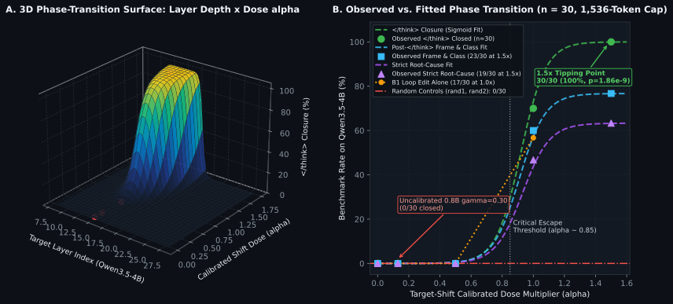
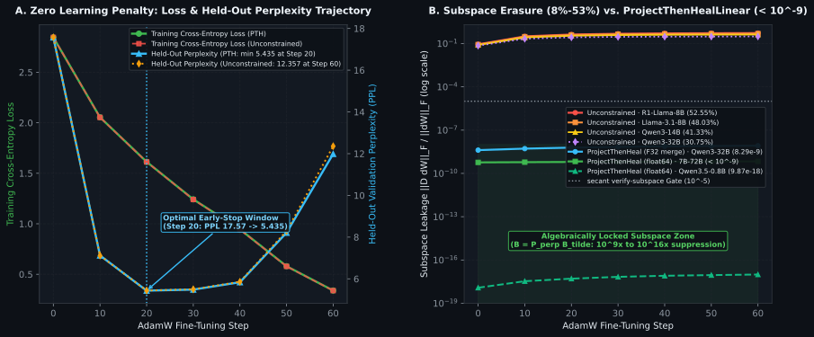

<div align="center">

# Secant

**Weight-Space Programming, Direct Quantized Surgery, and Subspace-Locked LoRA (`Project-Then-Heal`)**

[](https://professor-moody.github.io/secant/)
[](https://professor-moody.github.io/secant/PAPER)
[](https://opensource.org/licenses/Apache-2.0)
[](https://www.rust-lang.org/)
[](https://www.python.org/)

**[Documentation](https://professor-moody.github.io/secant/)** · **[Quickstart](https://professor-moody.github.io/secant/quickstart)** · **[Theory & Calibration](https://professor-moody.github.io/secant/theory-and-calibration)** · **[Quantized Surgery](https://professor-moody.github.io/secant/quantized-surgery)** · **[Project-Then-Heal](https://professor-moody.github.io/secant/project-then-heal)** · **[Technical Paper](https://professor-moody.github.io/secant/PAPER)**

<br/>


</div>

---

## Why Secant?

In [*"Sparks of Weight-Space Programming: LLMs can natively read & write neural network weights"*](https://rikiyat.github.io/blog/weight-space-programming/) (MIT CSAIL, Nov 2026), Rikiya Takehi, Jayden Teoh, Alex Zhang, and Omar Khattab demonstrated that frontier models can inspect raw transformer weights and edit behavioral circuits directly, such as suppressing `<think>` reasoning loops in `Qwen3.5-0.8B` by modifying `0.016%` of its parameters. In their **"What Comes Next?"** section, they called for:

> *"Turning what currently seems like black magic into a rigorous, reproducible engineering discipline"* and *"auditing without evaluation (e.g., backdoors directly from weights)."*

**We took this on and decided to see what we could do.**

**Secant** is a standalone Rust workspace (`secant-core`, `secant-cli`, `secant-ffi`) and Python library (`secant.nn.ProjectThenHealLinear`) for deterministic weight-space reading, scale-calibrated multi-subspace surgery (`0.8B` to `72.7B` across 17 checkpoints and 9 architecture families), direct in-place `Q8_0` / `Q4_K` GGUF block editing, static tensor payload security auditing, and subspace-locked LoRA fine-tuning.

---

## Our 7 Empirical Findings in Plain Words

1. **"Safe" model files can still crash C++ memory on the very first run (`secant sanitize`, `secant probe`):** Switching from Python `pickle` files to `.safetensors` stopped runnable Python code in model files, but C++ and GPU math kernels still blindly trust the numbers stored inside the weights to pick Mixture-of-Experts (MoE) routes, divide quantization scales, sort words, and index into memory. A `.safetensors` file with `NaN` in a router bias or a negative integer in a routing table passes every header check and crashes C++ memory on the first forward pass (and because `x86-64` and Apple Silicon `ARM64` convert `NaN` to integers differently in hardware, a file that runs quietly on a MacBook will segfault an `x86-64` server).
2. **Small reasoning models often fail on three stacked habits at once (`secant.capture`, `secant compose`):** On C++ crash triage, `Qwen3.5-0.8B` and `4B` get stuck in `<think>` loops (`B1`), falsely refuse benign crash dumps once the loop is opened (`B2`), and blame the crash line (`memcpy`) instead of the caller function that skipped the bounds check (`B3`). Fixing only one habit fails because the next habit in line blocks the answer; `secant compose` makes all three directions perpendicular (orthogonal) and edits them together.
3. **Why searching inside `<think>` for keywords is a mirage (The `93.3%` Copy-the-Input Control):** We did not lose a finding here; we caught a benchmarking trap *before* publishing that proved our real `0%` $\to$ `100%` result is genuine. A naive keyword search on `Qwen3.5-4B`'s unfinished `<think>` rambling scored `86.7%` (`26/30`), but feeding the **raw user prompt itself** (with **zero AI model**) into that same keyword scorer got **`93.3%` (`28/30`)** because every function in the call stack is already listed in the prompt! Under a **strict post-`</think>` scorer** that requires closing `</think>` and naming one culprit function over all the decoys, copying the prompt scores **`0/30` (`0%`)**, the unedited `4B` model scores **`0/30` (`0%`)**, and `Secant`'s calibrated edit (`1.5x` dose) reaches **`30/30` (`100%`)** closed and **`23/30` (`76.7%`)** exact culprit function.
4. **Why copying an edit percentage across model sizes fails (`0/30`), and how Target-Shift Calibration unlocks `100%` (`30/30`):** A `30%` weight-norm edit that fixes `<think>` loops on `0.8B` fixes **`0/30` (`0%`)** on `4B` because wider layers have larger internal activations (the `30%` nudge shifts the `4B` layer by `-0.90` instead of the `-7.38` needed to close `</think>`). **Target-Shift Calibration** solves for the exact weight dose needed to reach a target activation shift across all 17 models from `0.8B` to `72.7B`.
5. **You can audit vocabulary concepts and edit `.safetensors` or `.gguf` files directly on disk without PyTorch (`secant inspect`, `secant read`, `secant patch`, `secant verify-patch`):** `secant read` memory-maps tensors directly from disk, extracts their strongest directions in `float64`, and projects them onto the vocabulary table so you can see the exact words a layer promotes or suppresses without a GPU. `secant patch` edits only the target matrices in place and proves via SHA-256 that the other `98%+` of the file is bit-identical.
6. **8-bit (`Q8_0`) GGUF models can be edited directly on disk, while 4-bit (`Q4_K`) superblocks straddle head boundaries (`secant quant patch`, `secant quant witness`):** Each `Qwen3.5` `ssm_out` value head spans `128` columns, which divides evenly into four 32-weight `Q8_0` blocks ($128 = 4 \times 32$), enabling direct 34-byte block surgery (`98.5%` refusal removal, `10/10` eval agreement with edit-then-quantize). A 256-weight `Q4_K` superblock spans two neighboring 128-column heads with a shared scale, so `secant` blocks unsafe in-place `Q4_K` straddling.
7. **Standard LoRA fine-tuning erases `8.4%` to `52.6%` of a weight edit in 60 steps, and `ProjectThenHealLinear` locks that erasure below `10⁻⁹` (`secant heal`, `secant verify-subspace`):** During post-edit fine-tuning, AdamW's per-weight scaling pushes LoRA updates back into the directions you just removed (`8.42%` to `52.55%` erasure across `0.8B` to `72.7B`). `ProjectThenHealLinear` locks the LoRA output matrix inside the orthogonal complement ($B_{\text{locked}} = P_\perp(P_\perp(\tilde{B}))$) on every forward pass, holding leakage at $9.87 \times 10^{-18}$ to $1.08 \times 10^{-9}$ (`float64`) with zero learning penalty.

---

## What Secant Does

| Capability | CLI / Python | What It Solves |
|---|---|---|
| **Weight-Space Reading** | `secant inspect`<br>`secant read` | Deterministic non-FMA `float64` SVD over `.safetensors` and `.gguf` tensors with direct vocabulary unembedding projection (`--vocab-tensor`). |
| **Calibrated Multi-Subspace Surgery** | `secant compose`<br>`secant patch`<br>`secant verify-patch` | Two-pass `float64` Gram-Schmidt orthogonalization + **Target-Shift Calibration** (`beta = |Delta_target| / ||h_S||_2^2`) across model widths, with zero-copy `mmap` patching and bit-exact verification of all untouched bytes. |
| **Direct Quantized Surgery** | `secant quant patch`<br>`secant quant witness` | Edits 34-byte `Q8_0` blocks directly inside compressed `.gguf` files (`untouched_blocks_bit_identical: true`, `0.18%` to `0.92%` per-tensor Frobenius residual vs. `BF16` edit-then-quantize) and proves $\Pi_{128}$ block-grid equivariance. |
| **Subspace-Locked LoRA (`Project-Then-Heal`)** | `secant.nn.ProjectThenHealLinear`<br>`secant heal`<br>`secant verify-subspace` | Prevents post-surgical LoRA + AdamW fine-tuning from intruding into excised weight subspaces, holding writer leakage at $9.87 \times 10^{-18}$ to $1.08 \times 10^{-9}$ in `float64` and $1.46 \times 10^{-10}$ to $1.70 \times 10^{-8}$ in merged `F32`. |
| **Payload Security Auditing** | `secant sanitize`<br>`secant probe` | Audits and sanitizes structurally valid `.safetensors` and `.gguf` checkpoints for `NaN`/`Inf`/subnormal floats, out-of-bounds MoE router IDs, and alignment-gap data smuggling without running a forward pass. |

---

## Quickstart

```sh
# 1. Build the Rust CLI & C-ABI static/shared libraries
cargo build --release --workspace

# 2. Install the Python package (PyTorch ProjectThenHealLinear + contrastive capture)
pip install -e python/
```

### Read, Patch, and Verify a Checkpoint in 3 Commands

```sh
# Read top singular directions and project into vocabulary tokens without a GPU
secant read --model model.gguf --tensor "blk.15.ffn_down.weight" --vocab-tensor "token_embd.weight"

# Compose an orthogonal multi-subspace plan and patch in-place (BF16, F32, or Q8_0 GGUF)
secant compose --profile profile.json --vectors vec/ --out plan.json --json
secant quant patch --base model-q8_0.gguf --plan plan.json --out model-patched-q8_0.gguf --json

# Lock subsequent LoRA fine-tuning away from the edited subspace
secant heal --adapter lora_adapter.safetensors --basis basis.json --out lora_locked.safetensors --json
```

---

## Headline Empirical Results (`0.8B` to `72.7B` Across 17 Checkpoints)

Full derivations, visual charts, SHA-256 artifact manifests, and reproduction scripts are in the **[Documentation](https://professor-moody.github.io/secant/)** and **[Technical Paper](https://professor-moody.github.io/secant/PAPER)**:

<p align="center">
  
</p>

<p align="center">
  
</p>

| Model Checkpoint | Params | `B2` Shift Ratio vs. Random (`Shift` Pair) | `B3` Shift Ratio vs. Random (`Shift` Pair) | Unconstrained LoRA Subspace Intrusion | `ProjectThenHealLinear` Leakage (`float64` / `F32`) |
|---|---:|---:|---:|---:|---:|
| **`Qwen/Qwen3.5-0.8B`** (Live 60-step LM) | `0.8B` | `10/10` `<think>` close | `6/10` strict frame | `1.05e-02` max $\|D \Delta W\|$ | **`9.87e-18` / `2.49e-10`** |
| **`HuggingFaceTB/SmolLM2-1.7B-Instruct`** (20-step ROCm) | `1.7B` | **`68.0x`** (`-12.50` vs `-0.184`) | **`22.2x`** (`+9.17` vs `+0.413`) | `4.64e-03` max $\|D \Delta W\|$ | **`5.21e-18` / `1.46e-10`** |
| **`Qwen/Qwen3.5-4B`** (6-Arm Calibrated + Static Lock) | `4.0B` | **`30/30`** (`100%`) close at `1.5x` | **`23/30`** (`76.7%`) class & frame | `1.40e-03` (`BF16` merge floor) | **`7.01e-18` / `2.20e-10`** |
| **`mistralai/Mistral-7B-Instruct-v0.3`** | `7.2B` | **`663.9x`** (`+0.257` vs `-0.00039`) | **`98.9x`** (`+3.212` vs `-0.0325`) | `46.79%` ($\|DB\|_F/\|B\|_F$) | **`7.73e-10` / `3.87e-10`** |
| **`Qwen/Qwen2.5-7B-Instruct`** | `7.6B` | **`155.1x`** (`+4.654` vs `+0.0300`) | **`132.7x`** (`+20.82` vs `-0.1568`) | `31.34%` ($\|DB\|_F/\|B\|_F$) | **`7.55e-10` / `6.88e-09`** |
| **`meta-llama/Llama-3.1-8B-Instruct`** | `8.0B` | **`176.8x`** (`+3.539` vs `-0.0200`) | **`35.3x`** (`+8.888` vs `-0.2520`) | `48.03%` ($\|DB\|_F/\|B\|_F$) | **`7.62e-10` / `2.72e-09`** |
| **`deepseek-ai/DeepSeek-R1-Distill-Llama-8B`** | `8.0B` | **`1,269.9x`** (`+2.609` vs `+0.0021`) | **`143.3x`** (`+8.644` vs `-0.0603`) | **`52.55%`** ($\|DB\|_F/\|B\|_F$) | **`6.39e-10` / `2.13e-09`** |
| **`Qwen/Qwen3-8B`** | `8.2B` | **`219.7x`** (`+2.187` vs `-0.0100`) | **`29.1x`** (`+120.8` vs `+4.146`) | `39.53%` ($\|DB\|_F/\|B\|_F$) | **`7.14e-10` / `5.93e-09`** |
| **`google/gemma-2-9b-it`** | `9.2B` | **`127.9x`** (`+19.08` vs `+0.1492`) | **`87.2x`** (`+130.0` vs `+1.491`) | `41.05%` ($\|DB\|_F/\|B\|_F$) | **`6.53e-10` / `8.50e-10`** |
| **`allenai/OLMo-2-1124-13B-Instruct`** | `13.7B` | **`103.3x`** (`+1.250` vs `+0.0121`) | **`262.9x`** (`+7.341` vs `-0.0279`) | `30.73%` ($\|DB\|_F/\|B\|_F$) | **`1.08e-09` / `3.33e-09`** |
| **`microsoft/phi-4`** | `14.7B` | **`326.9x`** (`-3.399` vs `+0.0104`, abs) | **`48.7x`** (`+30.76` vs `+0.6322`) | `8.42%` ($\|DB\|_F/\|B\|_F$) | **`9.51e-10` / `1.70e-08`** |
| **`Qwen/Qwen3-14B`** | `14.8B` | **`252.5x`** (`+4.548` vs `+0.0180`) | **`492.8x`** (`+63.11` vs `-0.1281`) | `41.33%` ($\|DB\|_F/\|B\|_F$) | **`5.77e-10` / `4.68e-09`** |
| **`deepseek-ai/DeepSeek-R1-Distill-Qwen-14B`** | `14.8B` | **`66.7x`** (`+3.762` vs `+0.0564`) | **`64.9x`** (`+51.94` vs `+0.8008`) | `32.57%` ($\|DB\|_F/\|B\|_F$) | **`6.11e-10` / `2.78e-09`** |
| **`google/gemma-2-27b-it`** | `27.2B` | **`139.0x`** (`+542.8` vs `+3.905`) | **`196.0x`** (`+5152.2` vs `-26.29`) | `11.54%` ($\|DB\|_F/\|B\|_F$) | **`7.16e-10` / `7.54e-10`** |
| **`Qwen/Qwen3-32B`** | `32.8B` | **`158.6x`** (`+18.89` vs `+0.1191`) | **`510.5x`** (`+41.52` vs `-0.0813`) | `30.75%` ($\|DB\|_F/\|B\|_F$) | **`4.83e-10` / `8.29e-09`** |
| **`deepseek-ai/DeepSeek-R1-Distill-Llama-70B`** | `70.6B` | **`537.1x`** (`+8.301` vs `-0.0155`) | `L32 down_proj` (`234.9M` params) | `20.24%` ($\|DB\|_F/\|B\|_F$) | **`5.66e-10` / `3.98e-08`** |
| **`Qwen/Qwen2.5-72B-Instruct`** | `72.7B` | **`134.2x`** (`+9.043` vs `+0.0674`) | `L40 down_proj` (`242.2M` params) | `36.94%` ($\|DB\|_F/\|B\|_F$) | **`9.85e-10` / `1.58e-08`** |

---

## Documentation

The full scientific documentation is hosted at **[https://professor-moody.github.io/secant/](https://professor-moody.github.io/secant/)**:

1. **[Overview & Empirical Summary](https://professor-moody.github.io/secant/)**: Capabilities, $\alpha$-dose-response phase transition (`0% -> 70% -> 100%`), and cross-family table.
2. **[Quickstart & Live CLI Receipts](https://professor-moody.github.io/secant/quickstart)**: End-to-end CLI and Python examples with SHA-256 bracketed JSON receipts.
3. **[Mathematical Theory & Scale Calibration](https://professor-moody.github.io/secant/theory-and-calibration)**: Contrastive capture, `SNR_proj`, Gram-Schmidt orthogonalization, and Target-Shift Calibration.
4. **[Quantized Block Surgery (`Q8_0` & `Q4_K`)](https://professor-moody.github.io/secant/quantized-surgery)**: The $\Pi_{128}$ Quantization Commutation Theorem and direct 34-byte `Q8_0` block editing.
5. **[Project-Then-Heal Subspace-Locked LoRA](https://professor-moody.github.io/secant/project-then-heal)**: Why AdamW rotates gradients back into excised subspaces and how $B = P_\perp \tilde{B}$ locks writer leakage.
6. **[CLI, Python & C-ABI Reference](https://professor-moody.github.io/secant/cli-and-python-reference)**: Flags, exit codes, JSON schemas, `secant.nn`, and `secant.h` FFI symbols.
7. **[Container Geometry & Payload Security](https://professor-moody.github.io/secant/payload-security)**: Boundary-3 static auditing (`sanitize`, `probe`) for `.safetensors` and `.gguf` files.
8. **[Technical Paper](https://professor-moody.github.io/secant/PAPER)**: Complete self-contained paper with formal propositions and proofs.

---

## Citation & References

If you build on Secant, please cite both the foundational MIT CSAIL Weight-Space Programming work and Secant:

```bibtex
@misc{takehi2026weightspace,
  author       = {Takehi, Rikiya and Teoh, Jayden and Zhang, Alex and Khattab, Omar},
  title        = {Sparks of Weight-Space Programming: {LLMs} can natively read \& write neural network weights},
  year         = {2026},
  month        = nov,
  institution  = {MIT CSAIL},
  howpublished = {\url{https://rikiyat.github.io/blog/weight-space-programming/}}
}

@software{moody2026secant,
  author       = {Moody, Professor},
  title        = {Secant: Direct Multi-Subspace Weight Surgery, Quantized Block-Grid Equivariance, and Subspace-Locked LoRA},
  year         = {2026},
  url          = {https://github.com/professor-moody/secant}
}
```
