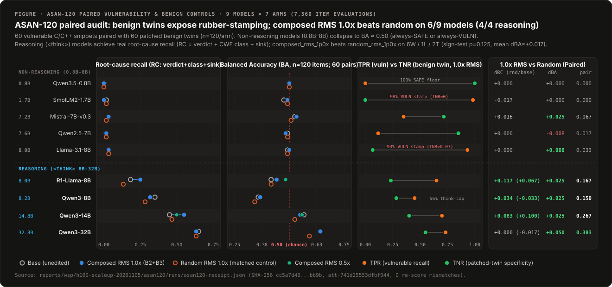
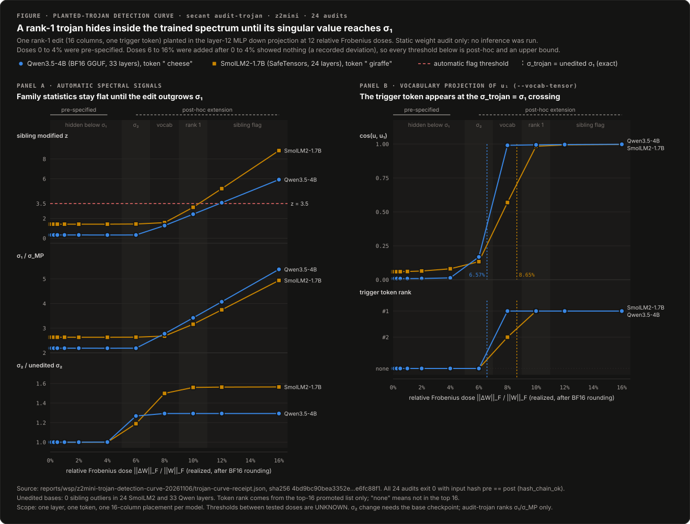

<div align="center">


# Secant

**Deterministic Weight-Space Programming, In-Place Quantized Block Surgery (`Q8_0`), Static Checkpoint Auditing, and Subspace-Locked LoRA (`Project-Then-Heal`)**

[](https://professor-moody.github.io/secant/)
[](https://professor-moody.github.io/secant/paper)
[](https://opensource.org/licenses/Apache-2.0)
[](https://www.rust-lang.org/)
[](https://www.python.org/)

**[Documentation](https://professor-moody.github.io/secant/)** · **[Quickstart](https://professor-moody.github.io/secant/quickstart)** · **[Theory & Calibration](https://professor-moody.github.io/secant/theory-and-calibration)** · **[Quantized Surgery](https://professor-moody.github.io/secant/quantized-surgery)** · **[Project-Then-Heal](https://professor-moody.github.io/secant/project-then-heal)** · **[Payload Security](https://professor-moody.github.io/secant/payload-security)** · **[Technical Paper](https://professor-moody.github.io/secant/paper)**

<br/>


</div>

---

## Overview

In [*"Sparks of Weight-Space Programming: LLMs can natively read & write neural network weights"*](https://rikiyat.github.io/blog/weight-space-programming/) (MIT CSAIL, Nov 2026), Takehi, Teoh, Zhang, and Khattab showed that frontier models can inspect transformer weights and edit behavioral circuits directly, calling for *"turning what currently seems like black magic into a rigorous, reproducible engineering discipline"* and *"auditing without evaluation."*

**Secant** is a standalone Rust workspace (`secant-core`, `secant-cli`, `secant-ffi`) and Python library (`secant.nn.ProjectThenHealLinear`, `secant.capture`) for verifiable weight-space surgery and subspace-locked post-edit adaptation. Every operation is bracketed by pre/post SHA-256 receipts and explicit floating-point invariants.

---

## Core Scientific & Engineering Findings

Full mathematical derivations, regime boundaries, and SHA-256 receipts are published in the **[Documentation](https://professor-moody.github.io/secant/)** and **[Technical Paper](https://professor-moody.github.io/secant/paper)**.

### 1. Sparse Rank-1 Weight Surgery & Multi-Subspace Composition (`secant.capture`, `secant compose`)
- **Top-K Column-Sparse Rank-1 Surgery:** Instead of modifying every column of an MLP writer matrix `W`, Secant selects the top-`K` (`K = 64` or `128`) columns `S` ordered by reference activation magnitude `|h_ref|` and solves analytically for the step size `beta = shift / ||h_S||_2^2`. Across 15 model architectures (`0.8B` to `32.8B`), sparse updates touch `< 2%` of layer weights while realizing the exact target shift to within `7.99e-15` in `float64`.
- **Two-Pass Float64 Gram-Schmidt Composition:** Sequential rank-1 edits along correlated directions (`security`, `math`, `science`, `code`) overwrite one another (`0.08` to `0.31` shift drift). `secant compose` orthonormalizes the row basis `D` via two-pass modified Gram-Schmidt in `float64` (`max |D D^T - I_k| < 1e-12`, measured `< 1e-15`), eliminating cross-direction interference.
- **Scale-Calibrated Dose Response (`Qwen3.5-4B`):** Copying a fixed Frobenius norm ratio from `0.8B` to `4B` closes `0/30` `<think>` loops because wider layers have different activation scales. Target-Shift Calibration produces a clean transition on `Qwen3.5-4B` (`n = 30`, strict post-`</think>` scoring): `0/30` (`0%`) at baseline and `0.5x` dose, `21/30` (`70%`) at `1.0x`, and `30/30` (`100%`) closed with `23/30` (`76.7%`) exact culprit frame at `1.5x` (paired McNemar `p = 1.86e-9`).

### 2. Direct In-Place `mmap` & 34-Byte `Q8_0` Quantized Block Surgery (`secant patch`, `secant quant patch`)
- **Sub-Tensor Quantized Block Editing on Disk:** Rather than loading full `BF16` models into GPU RAM, editing them, and re-quantizing multi-gigabyte checkpoints from scratch, `secant quant patch` memory-maps `.gguf` files directly on disk, decodes only the 34-byte `Q8_0` blocks (2-byte `f16` scale `d_b` + 32 `int8` quants) that intersect the sparse column support `S`, applies the rank-1 update, and re-packs `d_b = max_i |v_i| / 127` in place. Over `98%` of the file remains bit-for-bit untouched (`0.18%` to `0.92%` Frobenius residual vs. full `BF16` edit-then-quantize).
- **The `Pi_128` Quantization Commutation Boundary (`Q8_0` vs. `Q4_K`):** Because each 128-column attention/SSM head divides into exactly four 32-weight `Q8_0` blocks (`128 = 4 x 32`), `Q8_0` block surgery is head-local. By contrast, a 256-weight `Q4_K` superblock spans two neighboring 128-column heads with a shared superblock scale; `secant quant witness` measures this cross-head leakage and `secant quant patch` refuses non-`Q8_0` tensors (including `Q4_K` superblocks that straddle head boundaries).

### 3. `Project-Then-Heal`: Subspace-Locked LoRA Under AdamW (`secant.nn.ProjectThenHealLinear`, `secant heal`)
- **Why Gradient Projection Alone Leaks Under AdamW (`36/36` Configurations, `PASS 108/108` Arm-Runs per LR, `216` Total):** When fine-tuning an edited model with standard LoRA (`dW = (alpha / r) B A`) to recover fluency, unconstrained updates write back into `span(D)` (`0.82% - 8.51%` relative leakage), erasing the surgical edit. Even when the raw gradient is projected into `ker(D)` (`g_t <- P_perp g_t`) before `AdamW.step()`, AdamW divides each coordinate by its running second-moment estimate `sqrt(v_hat_t) + eps` (a non-isotropic diagonal preconditioner `S_t^{-1}`). Because `D S_t^{-1} P_perp != 0` for non-axis-aligned directions `D`, AdamW rotates orthogonal gradients back into `span(D)` after step 1 across all `36/36` tested configurations (`1.56% - 2.98%` orthogonal-target leakage at step 60 across our 3-arm, 108-run-per-LR (`216` total) optimizer ablation on `0.8B`, `4B`, and `7B` layer-16 `down_proj` geometries).
- **Forward-Graph Double Projection (`P_perp(P_perp B_tilde)`):** Building on subspace-constrained LoRA methods (Safe LoRA, Hsu et al. 2024; SaLoRA, Li et al. ICLR 2025; OPLoRA, Xiong & Xie AAAI 2026; OGPSA, Sun et al. 2026), `ProjectThenHealLinear` locks the LoRA output factor inside the forward pass via a twice-applied `float64` projection `B_locked = P_perp(P_perp(B_tilde))` where `P_perp = I - D^T D` is evaluated as `B - D^T(D B)` in `O(k * d_out * r)` time without ever allocating a `d_out x d_out` matrix.
- **Working-Dtype Precision Floor:** For a true `float64` module (Regime A live causal-LM fine-tuning on `Qwen3.5-0.8B` and `SmolLM2-1.7B`), realized writer leakage `max |D dW|` stays at **`5.21e-18` to `9.87e-18`**. For a `float32` module whose projection is computed in `float64` and rounded back to `float32` (15-model H100 Stage-1 sweep, `0.8B` to `32.8B`), leakage stays at the `float32` rounding floor (**`1.78e-10` to `8.67e-10`**).

### 4. Paired `ASAN-120` Vulnerability & Benign-Twin Benchmark and Static Spectral Trojan Auditing
- **Paired `ASAN-120` Vulnerability & Patched-Benign Twin Evaluation (`9` Models x `7` Arms = `7,560` Item Evaluations):** Vulnerable-only benchmarks cannot separate a real C/C++ vulnerability detector from a rubber-stamping model. On `ASAN-120` (60 vulnerable C/C++ functions paired with 60 minimally patched benign twins across 12 CWE bug classes, 4-way validated under `gcc/clang -O0/-O2` with `ASan+UBSan+MSan`), non-reasoning models (`0.8B` to `8B`) collapse to trivial one-sided predictors (`BA = 0.475` to `0.533`, `RC <= 0.067`). Across all 9 models, `composed_rms_1p0x` beats its norm-matched random control `random_rms_1p0x` on balanced accuracy on **`6` of `9` models (`6W / 1L / 2T`, exact sign-test `p = 0.125`, mean `dBA = +0.017`)**, including **`4` of `4` `<think>` reasoning models**, lifting strict root-cause recall (`RC = verdict + CWE class + sink`) from `0.450` to **`0.550` (`+10.0 pp`)** on `Qwen3-14B` and from `0.183` to **`0.250` (`+6.7 pp`)** on `DeepSeek-R1-Distill-Llama-8B`.
- **Static Spectral Trojan Phase Transition (`secant audit-trojan`) & Payload Sanitization (`secant sanitize`, `secant probe`):** `secant audit-trojan` (`secant read --detect-anomalies --marchenko-pastur`) implements a **two-stage static spectral detector** without a GPU: Stage 1 iteratively peels outlier singular values ($\sigma_i > \sigma_{MP}$) by subtracting their squared Frobenius energy ($\|W\|_F^2 - \sum_{i=1}^k \sigma_i^2$, the exact Frobenius energy of the rank-$k$ ablated matrix $W - \sum_{i=1}^k \sigma_i u_i v_i^\top$) until the residual Marchenko-Pastur bulk edge $\sigma_{MP}$ converges to a fixed point, alongside row/column norm spike detection (`zero_rows`, `collapsed_rows`, `spike_cols`); Stage 2 scores each tensor's peeled $\sigma_1/\sigma_{MP}$ ratio against its architectural sibling layer family (`blk.*.ffn_down.weight`, `model.layers.*.mlp.down_proj.weight`) via the Iglewicz-Hoaglin modified $z$-score ($z_{\text{rob}} > 3.5$, separating planted spikes from natural high-energy boundary layers) and projects the leading left singular vector $u_1$ onto `--vocab-tensor` ($E \cdot u_1$) to surface promoted trigger tokens. Controlled rank-1 trigger injection across 24 static audits (12 relative doses on each of 2 models) tracks the nominal singular-value crossover reference $g^* = \sigma_1(W)/\|W\|_F$ (`6.57%` on `Qwen3.5-4B` BF16 GGUF and `8.65%` on `SmolLM2-1.7B` SafeTensors). For multiplicative GGUF FP16 block scales across all 10 standard quantized formats (`Q4_0`, `Q4_1`, `Q5_0`, `Q5_1`, `Q8_0`, `Q2_K`, `Q3_K`, `Q4_K`, `Q5_K`, `Q6_K`), `secant sanitize` allowlists zero and subnormal values, flags only NaN or infinity by the exponent test `(bits & 0x7C00) == 0x7C00` (`0.0%` false-positive rate across `186,870,528` quantized blocks in `10 / 10` checkpoints), pairs with `secant probe --class all --out-dir <DIR>` for deterministic out-of-the-box synthetic witness generation across all four Boundary-3 failure classes (`class1..class4`), and zeroes non-finite blocks only in an explicitly requested repaired copy with pre/post SHA-256 verification.

### 5. Boundary-3 Payload Checks Across CPU and GPU Runtimes

`SafeTensors::deserialize()` proves five structural invariants: tensor offsets are contiguous and ordered, the shape-product bit count does not overflow, that count is byte-aligned, the byte count equals the declared span, and the final payload end equals the input length. It then returns a borrowed payload slice without inspecting its numerical values. Secant calls this remaining value-level trust boundary **Boundary 3**.

The zero-false-positive pre-load standard keeps four payload roles separate:

| Rule | Scope | Pre-load rule |
| :--- | :--- | :--- |
| **S-0** | Container headers and `config.json` | Use checked 64-bit spans, match tensor shapes to the architecture, require scalar loads to have `numel == 1`, and enforce `1 <= expert_used_count <= num_experts`. |
| **B3-1** | Unquantized float weights, norms, and router biases | Reject NaN and infinity with dtype-specific bitwise exponent checks. |
| **B3-2A** | Multiplicative GGUF block scales (`Q4_0`, `Q4_1`, `Q5_0`, `Q5_1`, `Q8_0`, `Q2_K`, `Q3_K`, `Q4_K`, `Q5_K`, `Q6_K` `d`, `dmin`, `m`) | Permit `0.0` and FP16 subnormals; flag only `(bits & 0x7C00) == 0x7C00`, then zero the non-finite block in repair mode. |
| **B3-2B** | Divisor activation and KV scales such as `input_scale`, `k_scale`, `v_scale`, `q_scale`, `y_scale`, `prob_scale`, and `*scale_inv`, plus `rope_freqs` | Require a finite value at least `--divisor-floor` (default `1e-12f`) and non-zero `rope_freqs`; `--clamp-nonfinite` clamps only non-finite divisor scales while leaving finite non-positive/below-floor scales as findings. |
| **B3-3** | Routing tensors (`tid2eid`, `expert_id*`) and integer index tensors (`g_idx`, `expert_map`, `full_row_indices`, `hash_indices_table`) | Apply two-sided bounds (`[0, bound)`, or `[-1, bound)` for `expert_map`) before indexing, and fail closed (`UNKNOWN`, exit `2`) when an index tensor has no inferable upper bound. |

The B3-2A allowlist is required by the formats, not a tolerance shortcut. `Q8_0` decodes weights as $d \cdot q_i$, and `Q4_K` decodes them as $d \cdot sc_j \cdot q - dmin \cdot m_j$. Zero-padded blocks can therefore contain `d = 0.0`. Small `Q4_K` blocks naturally produce FP16 subnormal multipliers when a sub-block scale is divided by 63; one measured example is `d = 4.55e-05` in row 0 of `blk.0.ffn_down_exps`, below the normal FP16 floor of approximately `6.1035e-05`. These values multiply weights and do not create a divisor failure. B3-2B scales do appear in division or reciprocal paths, so they use the positive floor instead.

The pre-load check also avoids hardware-dependent outcomes. On x86-64, `CVTTSS2SI` and `VCVTTPS2DQ` return `0x80000000` (`INT32_MIN`) for qNaN and positive overflow, which can bypass an upper-only index check. ARM64 `FCVTZS` converts qNaN to `0` and saturates positive overflow to `INT32_MAX`, so the same checkpoint can take a different path. NVIDIA CUB radix sort has another deterministic ordering: `TwiddleIn` maps positive qNaN above `+Inf` and negative qNaN below `-Inf`. Removing non-finite values before casts, comparisons, and radix sorting gives every runtime the same finite input domain.

<p align="center">
  
</p>

<p align="center">
  
</p>

---

## Summary of Key Empirical Regimes

| Regime / Experiment | Models & Scale | Primary Metric | Unconstrained / Baseline | Secant (`Project-Then-Heal` / Calibrated Surgery) |
| :--- | :--- | :--- | :--- | :--- |
| **3-Arm Optimizer Ablation** (`108` runs/LR, `216` total) | Layer-16 `down_proj` (`0.8B`, `4B`, `7B`, `36` configs) | Relative subspace leakage `||D dW||_F / ||dW||_F` | Std LoRA: `0.82% - 8.51%`<br>Grad-Proj AdamW: `1.56% - 2.98%` | **`5.42e-10 - 1.05e-9`** (`float32` working dtype) |
| **Regime A: Live LM Healing** | `Qwen3.5-0.8B`, `SmolLM2-1.7B` | Post-surgery causal-LM healing leakage `max \|D dW\|` | `4.64e-3 - 1.05e-2` | **`5.21e-18 - 9.87e-18`** (`float64`) / **`<= 1.70e-8`** (`F32`) |
| **15-Model H100 Stage-1 Sweep** | `15` models (`0.8B` to `32.8B`) | Exact shift error & `float32` locked LoRA leakage | Grad-Proj AdamW: `0.33% - 1.67%` | Shift error **`<= 7.99e-15`**; leakage **`1.78e-10 - 8.67e-10`** |
| **Regime B: `<think>` Calibration** | `Qwen3.5-4B` (`n = 30` crash traces) | Loop closure & exact culprit attribution | `0/30` (`0%`) at baseline & fixed-ratio | **`30/30` (`100%`)** closed; **`23/30` (`76.7%`)** culprit (`p = 1.86e-9`) |
| **Paired `ASAN-120` Benchmark** (`7,560` evals) | `9` models x `7` arms (`60` vuln + `60` benign twins) | Balanced accuracy `BA` & strict root-cause `RC` | Non-reasoning: `BA = 0.475 - 0.533` (`RC <= 0.067`) | Beats random on **`6/9` models (`4/4` reasoning)**; `RC` **`+10.0 pp`** (`Qwen3-14B`), **`+6.7 pp`** (`R1-8B`) |
| **Static Spectral Trojan Sweep** (`24` audits, `2` models) | `Qwen3.5-4B` (GGUF), `SmolLM2-1.7B` (SafeTensors) | Dominant singular vector & vocab rank-1 trigger | Submerged below $g^* = \sigma_1(W)/\|W\|_F$ (`u1_cos <= 0.081`) | Crossover above **`g* = 6.57% / 8.65%`** (`u1_cos = 0.991 / 0.984` at `8% / 10%`, rank `1`) |

---

## Live CLI Demos (`inspect`, `analyze`, `compose`, `patch`, `verify-patch`, `probe`)

<p align="center">
  
  
</p>

---

## Command & Library Surface

| Stage | CLI / Python Surface | Purpose |
| :--- | :--- | :--- |
| **01 · Audit & Read** | `secant inspect` · `secant read`<br>`secant sanitize` · `secant probe` | Read-only `mmap` layout inspection, deterministic `float64` SVD with vocabulary token projection (`--vocab-tensor`), and static tensor payload sanitization. |
| **02 · Capture & Compose** | `secant.capture`<br>`secant compose` | Contrastive activation capture with held-out `SNR_proj` layer ranking, two-pass `float64` Gram-Schmidt orthogonalization, and Target-Shift Calibration (`beta = shift / ||h_S||_2^2`). |
| **03 · In-Place Patch** | `secant patch` · `secant verify-patch`<br>`secant quant patch` · `secant quant witness` | Zero-copy `mmap` surgery on `BF16`/`F16`/`F32` `.safetensors`/`.gguf` and direct 34-byte `Q8_0` GGUF block editing with SHA-256 byte-range verification. |
| **04 · Subspace-Locked LoRA** | `secant.nn.ProjectThenHealLinear`<br>`secant heal` · `secant verify-subspace` | Forward-pass left-nullspace LoRA locking (`B_locked = P_perp(P_perp(B_tilde))`) during PyTorch training and offline `.safetensors` LoRA adapter healing. |

---

## Quickstart

```sh
# 1. Build the Rust CLI and C-ABI static/shared libraries, and install secant into ~/.cargo/bin
cargo build --release --workspace
cargo install --path crates/secant-cli

# 2. Install the Python package (PyTorch ProjectThenHealLinear + contrastive capture)
pip install -e python/
```

### Read, Patch, and Lock a Checkpoint in 3 Commands

```sh
# 1. Read top singular directions on disk and project into vocabulary tokens without a GPU
secant read --model model.gguf --tensor "blk.15.ffn_down.weight" --vocab-tensor "token_embd.weight"

# 2. Compose an orthogonal multi-subspace plan and patch a Q8_0 GGUF checkpoint in place
secant compose --profile profile.json --vectors vec/ --target-shift -4.0 --out plan.json --json
secant quant patch --base model-q8_0.gguf --plan plan.json --out model-patched-q8_0.gguf --json

# 3. Lock a LoRA adapter away from the excised subspace, merge into the base copy, and verify orthogonality
secant heal --lora lora_adapter.safetensors --vectors vec/ --out lora_locked.safetensors --base model.safetensors --merge-out model_healed.safetensors --json
secant verify-subspace --base model.safetensors --healed model_healed.safetensors --vectors vec/ --tensors "model.layers.15.mlp.down_proj.weight" --json
```

### Conformance & Differential Oracle Testing

`cargo test --workspace` runs the standalone unit, property, and CLI integration suite out of the box. Four optional environment variables enable differential parity tests against external reference binaries and source trees (following a strict tri-state contract: unset prints `NOT_RUN` when invoked with `-- --nocapture`; set to an empty string panics; set to a valid path runs the differential check):

- `SECANT_ORACLE_BIN`: Path to the Go reference oracle binary for byte-exact differential receipt and exit-code parity across `inspect`, `read`, `analyze`, `compose`, `patch`, `verify-patch`, `heal`, `verify-subspace`, `probe`, `sanitize`, and `scan-sinks`.
- `SECANT_GGML_DIR`: Path to a local `llama.cpp` checkout (containing `ggml/`) to compile and link `ggml`'s C reference `dequantize_row_q8_0` / `dequantize_row_q4_K` against `secant-core`.
- `SECANT_BASELINE_BIN`: Path to a prior release `secant` binary for backward-compatibility contract verification.
- `SECANT_SINK_TREES`: Colon-separated list of C/C++/CUDA/Rust source directories compared byte-for-byte against the reference oracle in `scan_sinks_cli`.

---

## Documentation & Technical Paper

- **[Overview & Empirical Summary](https://professor-moody.github.io/secant/)**: Three-regime taxonomy, methodology controls, and cross-family results.
- **[Quickstart & Live CLI Receipts](https://professor-moody.github.io/secant/quickstart)**: End-to-end CLI and Python workflows with SHA-256 bracketed JSON receipts.
- **[Mathematical Theory & Scale Calibration](https://professor-moody.github.io/secant/theory-and-calibration)**: Contrastive capture, `SNR_proj`, Gram-Schmidt cross-projection compensation, and Target-Shift Calibration.
- **[Quantized Block Surgery (`Q8_0` & `Q4_K`)](https://professor-moody.github.io/secant/quantized-surgery)**: The `Pi_128` Quantization Commutation Theorem and 34-byte `Q8_0` block editing.
- **[Project-Then-Heal Subspace-Locked LoRA](https://professor-moody.github.io/secant/project-then-heal)**: Formal proof of AdamW diagonal preconditioner rotation and double-idempotent forward-pass projection.
- **[Container Geometry & Payload Security](https://professor-moody.github.io/secant/payload-security)**: Boundary-3 static auditing (`sanitize`, `probe`) for `.safetensors` and `.gguf` files.
- **[CLI, Python & C-ABI Reference](https://professor-moody.github.io/secant/cli-and-python-reference)**: Flags, exit codes, JSON schemas, `secant.nn`, and `secant.h` FFI symbols.
- **[Full Technical Paper](https://professor-moody.github.io/secant/paper)**: Self-contained paper with formal propositions, proofs, and limitations.

---

## Citation

```bibtex
@article{takehi2026sparks,
  title   = {Sparks of Weight-Space Programming: LLMs can natively read \& write neural network weights},
  author  = {Takehi, Rikiya and Teoh, Jayden and Zhang, Alex and Khattab, Omar},
  year    = {2026},
  month   = nov,
  url     = {https://rikiyat.github.io/blog/weight-space-programming/}
}

@software{keys2026secant,
  title   = {Secant: Deterministic Weight-Space Programming, In-Place Quantized Block Surgery, and Subspace-Locked LoRA},
  author  = {Keys, Nathan},
  year    = {2026},
  url     = {https://github.com/professor-moody/secant}
}
```
