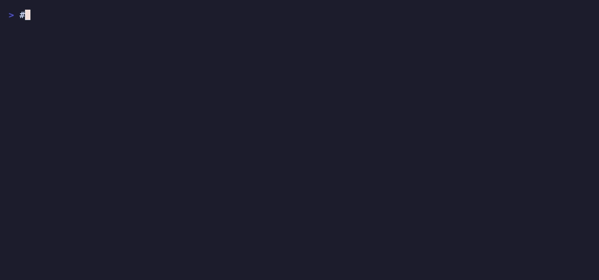

<div align="center">


# Secant

**Check model files before loading them. Keep chosen directions fixed during fine-tuning.**

[](https://professor-moody.github.io/secant/)
[](https://professor-moody.github.io/secant/paper)
[](https://m00dy.sh/notes/sparks-to-secant-weight-space-programming-series)
[](https://opensource.org/licenses/Apache-2.0)
[](https://www.rust-lang.org/)
[](https://www.python.org/)

[Recipes](docs/RECIPES.md) · [Test drive](examples/test-drive/README.md) · [PyTorch guide](docs/PYTORCH-10-LINE-HEALING-GUIDE.md) · [Technical paper](docs/PAPER.md)

</div>

## What Secant Does and Why It Matters

A model file can load successfully and still contain harmful weights. SafeTensors avoids pickle-style code execution during deserialization; GGUF describes tensors and metadata. Neither format proves that the weights behave as intended. Non-finite weights or corrupted scales can spoil outputs, and invalid routing indices can reach unsafe operations in runtimes that do not validate them. Finite weights can also carry a behavioral backdoor. Separately, legitimate fine-tuning can change behavior you meant to preserve.

Secant offers two practical tools:

- **Check a downloaded model before loading it.** `secant inspect` lists tensors and storage formats. `secant sanitize` checks supported `.safetensors` and `.gguf` payloads and companion configuration files, without a GPU or inference. It can write a repaired copy for supported numerical defects. A clean scan means those checks passed; it does not rule out behavioral backdoors.
- **Constrain a PyTorch LoRA adapter.** `ProjectThenHealLinear` keeps its update out of output directions you supply. You can merge it into an ordinary `nn.Linear`, with zero additional adapter operations at inference. The lock is local to the selected layers and directions; evaluate model behavior and check leakage again after export.

The retained scanner benchmark observed **0.0% false positives on 105 default configurations per platform**, comprising 100 synthetic configurations and five retained configurations. This is a measured corpus result, not a guarantee for every production model. The [benchmark report](docs/benchmarks/benign-fpr-v0.3.0.md) separates controls, formats, and historical coverage; its [JSON receipt](docs/benchmarks/benign-fpr-v0.3.0.json) has SHA-256 `63ac1125e6a1f87f65acd5c3163e7fdf3ad2c479a1dee8968c8dd0bf80a64fac`.

## Try It in 30 Seconds

From a checkout, run:

```sh
python3 examples/test-drive/test_drive.py
```

No GPU, Python packages, or model download is needed. The script creates tiny synthetic SafeTensors and GGUF files, runs nine checks covering clean controls, numerical defects, repair, and a rank-one spectral change, then deletes its temporary files. Success ends with `RESULT: 9/9`. The first run builds the CLI if necessary and requires Rust; that build can take longer than 30 seconds. The nine checks are a small demonstration, not a general detection-rate benchmark.

## Practical Recipes and How-Tos

| You want to | Start here |
| --- | --- |
| Scan a downloaded Hugging Face model before vLLM or llama.cpp loads it | [1. Scan a downloaded model](docs/RECIPES.md#recipe-1-scan-a-downloaded-model) |
| Test your scanner with clean controls and numerical fixtures | [2. Test a scanner with synthetic fixtures](docs/RECIPES.md#recipe-2-test-a-scanner-with-synthetic-fixtures) |
| Repair supported corrupted scales into a separate, hash-verified copy | [3. Repair a copy and verify its hashes](docs/RECIPES.md#recipe-3-repair-a-copy-and-verify-its-hashes) |
| Add a protected LoRA layer and export a plain PyTorch layer | [4. Fine-tune and export in ten lines](docs/RECIPES.md#recipe-4-fine-tune-and-export-in-ten-lines) |
| Check whether a Q8_0 or Q4_K export preserved the chosen directions | [5. Verify a quantized export](docs/RECIPES.md#recipe-5-verify-a-quantized-export) |

For more context, read the [scanner evaluation guide](docs/OFFENSIVE-RESEARCHERS-GUIDE.md) or the [PyTorch walkthrough](docs/PYTORCH-10-LINE-HEALING-GUIDE.md).

## Install and Interpret Results

```sh
cargo install --path crates/secant-cli
# Optional Python package for fine-tuning
python3 -m pip install -e './python[torch]'
```

`inspect` describes a file; it does not scan its weight values. For `sanitize` and `verify-subspace`, use the exit code as well as the JSON report:

| Exit | Meaning | Next step |
| --- | --- | --- |
| `0` | The requested check passed, or sanitization published a copy that passed its rescan | Retain the receipt and continue your validation |
| `1` | Numerical findings remain, or a verification tolerance failed | Review the findings before loading the file |
| `2` | Usage, I/O, unsupported input, or an incomplete check | Resolve the error and rerun; treat the result as unknown |

A completed `audit-trojan` report can exit `0` while containing outliers. Read its findings; this command does not share `sanitize`'s finding gate. New receipt and output paths must not already exist. See the [CLI and Python reference](docs/cli-and-python-reference.md) for command-specific contracts.

## How It Works Under the Hood and Formal Guarantees

The [paper](docs/PAPER.md) retains the derivations, formal guarantees, commutation bounds, control arms, and benchmark tables. Its studies have different scopes: the completed response-benchmark cohort spans 17 model identities from 0.8B to 32.8B, while the separate 17-checkpoint Project-Then-Heal study reaches 72.7B using single shards for the largest checkpoints. The paper accounts for 59,440 retained H100 evaluation rows, including 300 partial Gemma-2-27B baseline rows. Those counts describe retained experiments, not fresh results from this test drive.

- **Static numerical checks.** The [payload reference](docs/payload-security.md) defines finite-value, divisor-scale, routing-index, and companion-config rules. Supported SafeTensors floating types include F64, F32, F16, BF16, F8_E4M3, and F8_E5M2. The scanner checks scale headers in ten GGUF block formats; unsupported types fail closed.
- **Spectral and reference comparison.** `audit-trojan` and `read --reference` expose unusual matrix structure or differences from a trusted checkpoint. Spectral outliers are review signals, not proof of malicious intent. The paper retains the measured detection limits and reference-diff studies.
- **Calibrated edits.** [Theory and calibration](docs/theory-and-calibration.md) derives the edit size for a supplied reference activation. That local equality does not guarantee a response on unseen prompts.
- **Quantized storage.** [Quantized surgery](docs/quantized-surgery.md) explains Q8_0 block edits, rounding error, commutation bounds, and why the Rust patcher refuses Q4_K surgery. Reading, sanitizing, and verifying Q4_K remain supported.
- **Constrained adapters.** [Project-Then-Heal](docs/project-then-heal.md) derives the double projection and documents finite-precision and downstream-layer limits. The adapter check and the stored merged-weight check measure different quantities.

<p align="center">
  
  
</p>

The [documentation home](docs/index.md), [technical quickstart](docs/quickstart.md), and [blog series](https://m00dy.sh/notes/sparks-to-secant-weight-space-programming-series) provide further examples. The [paper's experimental sections](docs/PAPER.md) provide receipt identities, controls, and adjusted statistics for benchmark claims.

## Citation

```bibtex
@software{keys2026secant,
  title   = {Secant: Deterministic Weight-Space Programming, In-Place Quantized Block Surgery, and Subspace-Locked LoRA},
  author  = {Keys, Nathan},
  year    = {2026},
  url     = {https://github.com/professor-moody/secant}
}
```
