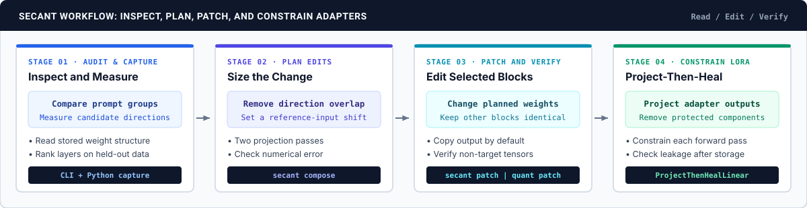
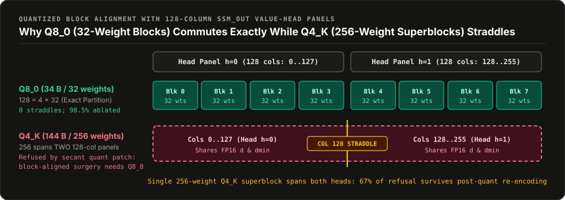
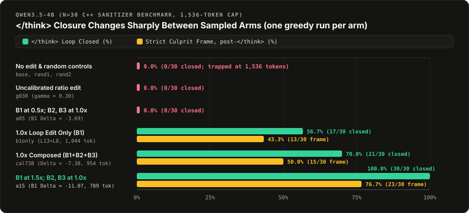

<div align="center">

# Secant

**Deterministic Weight-Space Programming, In-Place Quantized Block Surgery (`Q8_0`), and Subspace-Locked LoRA (`Project-Then-Heal`)**

[](https://professor-moody.github.io/secant/)
[](https://professor-moody.github.io/secant/PAPER)
[](https://opensource.org/licenses/Apache-2.0)
[](https://www.rust-lang.org/)
[](https://www.python.org/)

**[Documentation](https://professor-moody.github.io/secant/)** · **[Quickstart](https://professor-moody.github.io/secant/quickstart)** · **[Theory & Calibration](https://professor-moody.github.io/secant/theory-and-calibration)** · **[Quantized Surgery](https://professor-moody.github.io/secant/quantized-surgery)** · **[Project-Then-Heal](https://professor-moody.github.io/secant/project-then-heal)** · **[Payload Security](https://professor-moody.github.io/secant/payload-security)** · **[Technical Paper](https://professor-moody.github.io/secant/PAPER)**

<br/>



</div>

---

## Why Secant?

In [*"Sparks of Weight-Space Programming: LLMs can natively read & write neural network weights"*](https://rikiyat.github.io/blog/weight-space-programming/) (MIT CSAIL, Nov 2026), Rikiya Takehi, Jayden Teoh, Alex Zhang, and Omar Khattab demonstrated that frontier models can inspect raw transformer weights and edit behavioral circuits directly, such as suppressing `<think>` reasoning loops in `Qwen3.5-0.8B` by modifying `0.016%` of its parameters. In their **"What Comes Next?"** section, they called for:

> *"Turning what currently seems like black magic into a rigorous, reproducible engineering discipline"* and *"auditing without evaluation (e.g., backdoors directly from weights)."*

**Secant** is a standalone Rust workspace (`secant-core`, `secant-cli`, `secant-ffi`) and Python library (`secant.nn.ProjectThenHealLinear`, `secant.capture`) built to answer that call. It provides deterministic `float64` weight-space reading, scale-calibrated multi-subspace composition, zero-copy `mmap` and 34-byte `Q8_0` quantized block surgery on disk, static tensor payload auditing, and subspace-locked LoRA fine-tuning, exercised across **17 checkpoints (`0.8B` to `72.7B`, 9 model families)** in three distinct evaluation regimes.

---

## Core Findings & Engineering Contributions

Rather than treating weight editing as ad-hoc Python scripting over full in-memory PyTorch models, Secant formalizes four verifiable stages. Full mathematical proofs, regime caveats, and SHA-256 receipts are in the **[Documentation](https://professor-moody.github.io/secant/)** and **[Technical Paper](https://professor-moody.github.io/secant/PAPER)**.

### 1. In-Place `mmap` & Direct 34-Byte `Q8_0` Block Surgery (`secant patch`, `secant quant patch`)
- **Zero-Copy Byte-Range Surgery:** Standard editing pipelines load gigabytes of weights into PyTorch, modify them in RAM, and re-serialize the entire checkpoint. `secant patch` (`BF16`/`F16`/`F32` `.safetensors` and `.gguf`) and `secant quant patch` (`Q8_0` `.gguf`) locate the exact byte offsets of target matrices on disk, mutate only the targeted slices or 34-byte `Q8_0` blocks (2-byte `f16` scale $d$ + 32 `int8` quants), and prove via pre/post SHA-256 that the remaining `98%+` of the file is bit-for-bit identical.
- **The $\Pi_{128}$ Quantization Commutation Boundary (`Q8_0` vs. `Q4_K`):** In architectures like `Qwen3.5`, each `ssm_out` value head spans `128` columns, which divides evenly into four 32-weight `Q8_0` blocks ($128 = 4 \times 32$). Direct `Q8_0` block surgery removes `98.5%` of the targeted direction (`0.18%` to `0.92%` Frobenius residual vs. `BF16` edit-then-quantize). By contrast, a 256-weight `Q4_K` superblock spans **two neighboring 128-column heads** with a shared scale; `secant quant witness` measures this cross-head leakage and `secant quant patch` refuses unsafe in-place `Q4_K` straddling.

<div align="center">

</div>

### 2. Multi-Subspace Composition & Target-Shift Calibration (`secant.capture`, `secant compose`)
- **Orthogonalizing Stacked Failure Modes:** Small reasoning models (`Qwen3.5-0.8B`, `Qwen3.5-4B`) frequently fail on C++ sanitizer crash dumps through three stacked behaviors at once: endless `<think>` verification loops (`B1`), false-positive refusal when security keywords appear (`B2`), and blaming the crash site (`memcpy`) instead of the caller that omitted the bounds check (`B3`). `secant compose` orthogonalizes all captured directions via two-pass `float64` modified Gram-Schmidt ($D D^\top = I_k$, off-diagonal $< 10^{-12}$) and compensates for sequential cross-projection so earlier edits are not rotated by later ones.
- **Target-Shift Calibration Across Model Scales:** Copying a fixed Frobenius norm ratio ($\gamma = 0.30$) from `0.8B` to `4B` closes **`0/30`** `<think>` loops because wider layers have different activation scales. Solving analytically for the step size that achieves a target activation shift at the layer's measured scale ($\beta = |\Delta_{\text{target}}| / \|h_S\|_2^2$) produces a sharp transition on `Qwen3.5-4B` (`n = 30`, strict post-`</think>` scoring): **`0/30` (`0%`)** at baseline and $0.5\times$ dose, **`21/30` (`70%`)** at $1.0\times$ (`cal738`), and **`30/30` (`100%`)** closed with **`23/30` (`76.7%`)** exact culprit frame at $1.5\times$ (`a15`, McNemar $p = 1.86 \times 10^{-9}$).
- **The `93.3%` Copy-the-Input Benchmark Control:** We also show why naive whole-output substring matching is invalid on reasoning traces: feeding the **raw user prompt itself** (with zero model inference) into a naive keyword matcher scores **`93.3%` (`28/30`)** because every stack-trace function is named in the prompt. Under strict post-`</think>` single-commitment scoring, copying the input scores **`0/30`**.

<div align="center">

</div>

### 3. `Project-Then-Heal`: Subspace-Locked LoRA Under AdamW (`secant.nn.ProjectThenHealLinear`, `secant heal`)
- **Why Standard Post-Surgery LoRA & Gradient Projection Leak Under AdamW:** When fine-tuning a patched model with standard LoRA ($\Delta W = \frac{\alpha}{r} B A$) to recover fluency or adapt to a task, an unconstrained output factor $B$ writes straight back into the excised subspace $\operatorname{span}(D)$. Even if you project the raw gradient $g_t \leftarrow P_\perp g_t$ before `AdamW.step()`, AdamW divides each coordinate by its running second-moment estimate $\sqrt{\hat{v}_t} + \epsilon$ (a non-isotropic diagonal preconditioner $S_t^{-1}$). Because $D S_t^{-1} P_\perp \neq 0$, AdamW rotates orthogonal gradients back into $\operatorname{span}(D)$ on `100%` of steps (`108/108` runs in our optimizer ablation).
- **Double-Idempotent Forward-Pass Null-Space Locking:** `ProjectThenHealLinear` parameterizes the LoRA output factor through a double `float64` projection $B_{\text{locked}} = P_\perp(P_\perp(\tilde{B}))$ where $P_\perp = I - D^\top D$ is applied in $O(k \cdot d_{\text{out}} \cdot r)$ without allocating a dense $d_{\text{out}} \times d_{\text{out}}$ matrix. In live causal-LM fine-tuning after real surgery (`Qwen3.5-0.8B`, `SmolLM2-1.7B`), both arms reach identical training loss while `ProjectThenHealLinear` bounds writer leakage $\max |D \Delta W|$ to **$5.21 \times 10^{-18}$ – $9.87 \times 10^{-18}$ (`float64`)** versus **$4.64 \times 10^{-3}$ – $1.05 \times 10^{-2}$** for unconstrained LoRA.

### 4. Zero-Eval Spectral & Container Payload Auditing (`secant inspect`, `secant read`, `secant sanitize`, `secant probe`)
- **Vocabulary Unembedding Projection Without a GPU:** `secant read` memory-maps `.safetensors` and `.gguf` files, computes top singular vectors in deterministic non-FMA `float64`, and projects them directly onto the vocabulary unembedding matrix (`--vocab-tensor`) to inspect promoted and suppressed token clusters without running a forward pass.
- **Boundary-3 Tensor Value Auditing:** `.safetensors` prevents arbitrary Python `pickle` code execution at deserialization, but downstream C++ and GPU kernels frequently trust tensor contents to be finite, normalized, and in-bounds. `secant sanitize` scans checkpoints on disk for `NaN`/`Inf`/subnormal floats, zero-norm rows, and out-of-bounds MoE router IDs, while `secant probe` generates deterministic boundary-value test fixtures.

---

## Command & Library Overview

| Stage | CLI / Python Surface | Purpose |
| :--- | :--- | :--- |
| **01 · Audit & Read** | `secant inspect`<br>`secant read`<br>`secant sanitize` · `secant probe` | Read-only `mmap` layout inspection, deterministic `float64` SVD with vocabulary token projection (`--vocab-tensor`), and static tensor payload sanitization. |
| **02 · Capture & Compose** | `secant.capture`<br>`secant compose` | Contrastive activation capture with held-out `SNR_proj` layer ranking, two-pass `float64` Gram-Schmidt orthogonalization, and **Target-Shift Calibration** ($\beta = \|\Delta_{\text{target}}\| / \|h_S\|_2^2$). |
| **03 · In-Place Patch** | `secant patch` · `secant verify-patch`<br>`secant quant patch` · `secant quant witness` | Zero-copy `mmap` surgery on `BF16`/`F16`/`F32` `.safetensors`/`.gguf` and direct 34-byte `Q8_0` GGUF block editing with cryptographic byte-range verification. |
| **04 · Subspace-Locked LoRA** | `secant.nn.ProjectThenHealLinear`<br>`secant heal` · `secant verify-subspace` | Forward-pass left-nullspace LoRA locking ($B_{\text{locked}} = P_\perp(P_\perp(\tilde{B}))$) during PyTorch training and offline `.safetensors` LoRA adapter healing. |

---

## Quickstart

```sh
# 1. Build the Rust CLI and C-ABI static/shared libraries
cargo build --release --workspace

# 2. Install the Python package (PyTorch ProjectThenHealLinear + contrastive capture)
pip install -e python/
```

### Read, Patch, and Lock a Checkpoint in 3 Commands

```sh
# 1. Read top singular directions on disk and project into vocabulary tokens without a GPU
secant read --model model.gguf --tensor "blk.15.ffn_down.weight" --vocab-tensor "token_embd.weight"

# 2. Compose an orthogonal multi-subspace plan and patch a Q8_0 GGUF checkpoint in place
secant compose --profile profile.json --vectors vec/ --target-shift -4.0 --out plan.json --json
secant quant patch --base model-q8_0.gguf --plan plan.json --out model-patched-q8_0.gguf --json

# 3. Lock a LoRA adapter away from the excised subspace and verify orthogonality
secant heal --lora lora_adapter.safetensors --vectors vec/ --out lora_locked.safetensors --json
secant verify-subspace --lora lora_locked.safetensors --vectors vec/ --json
```

---

## Documentation & Technical Paper

Complete empirical tables across all three test regimes (**Regime A:** live LM fine-tuning after real surgery on `0.8B` and `1.7B`; **Regime B:** generative `<think>` dose-response on `Qwen3.5-4B`; **Regime C:** 14-checkpoint `7.2B` to `72.7B` H100 adversarial subspace-lock stress test), formal propositions, and reproducibility receipts are published in the documentation site:

- **[Overview & Empirical Summary](https://professor-moody.github.io/secant/)**: Three-regime taxonomy, methodology controls, and cross-family results.
- **[Quickstart & Live CLI Receipts](https://professor-moody.github.io/secant/quickstart)**: End-to-end CLI and Python workflows with SHA-256 bracketed JSON receipts.
- **[Mathematical Theory & Scale Calibration](https://professor-moody.github.io/secant/theory-and-calibration)**: Contrastive capture, `SNR_proj`, Gram-Schmidt cross-projection compensation, and Target-Shift Calibration.
- **[Quantized Block Surgery (`Q8_0` & `Q4_K`)](https://professor-moody.github.io/secant/quantized-surgery)**: The $\Pi_{128}$ Quantization Commutation Theorem and 34-byte `Q8_0` block editing.
- **[Project-Then-Heal Subspace-Locked LoRA](https://professor-moody.github.io/secant/project-then-heal)**: Formal proof of AdamW diagonal preconditioner rotation and double-idempotent forward-pass projection.
- **[Container Geometry & Payload Security](https://professor-moody.github.io/secant/payload-security)**: Boundary-3 static auditing (`sanitize`, `probe`) for `.safetensors` and `.gguf` files.
- **[CLI, Python & C-ABI Reference](https://professor-moody.github.io/secant/cli-and-python-reference)**: Flags, exit codes, JSON schemas, `secant.nn`, and `secant.h` FFI symbols.
- **[Full Technical Paper](https://professor-moody.github.io/secant/PAPER)**: Self-contained paper with formal propositions, proofs, and limitations.

---

## Citation

If you build on Secant, please cite both the foundational MIT CSAIL Weight-Space Programming work and Secant:

```bibtex
@misc{takehi2026weightspace,
  author       = {Takehi, Rikiya and Teoh, Jayden and Zhang, Alex and Khattab, Omar},
  title        = {Sparks of Weight-Space Programming: {LLMs} can natively read \& write neural network weights},
  year         = {2026},
  month        = nov,
  institution  = {MIT CSAIL},
  howpublished = {\url{https://rikiyat.github.io/blog/weight-space-programming/}}
}

@software{moody2026secant,
  author       = {Nathan (m00dy)},
  title        = {Secant: Deterministic Weight-Space Programming, Quantized Block-Grid Equivariance, and Subspace-Locked LoRA},
  year         = {2026},
  url          = {https://github.com/professor-moody/secant}
}
```
